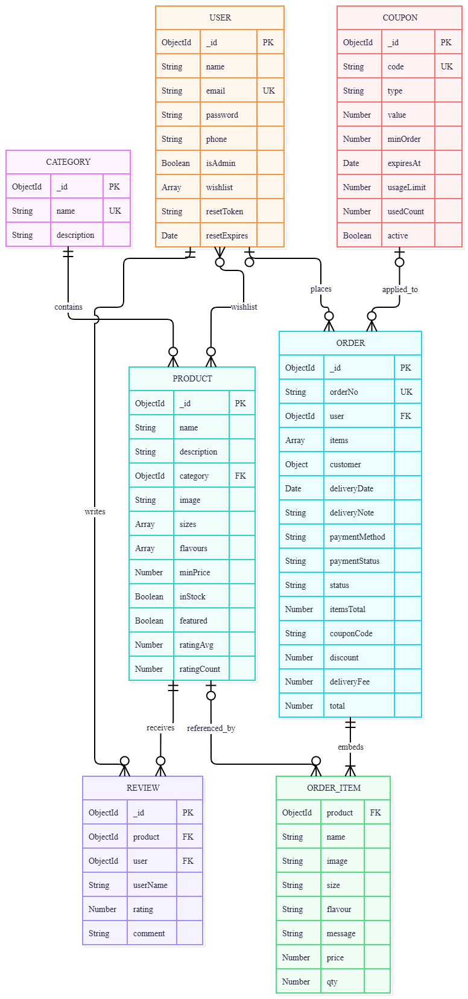

# TasteTrack – Cake Store Web Application

TasteTrack is an online cake store developed using the MERN stack (MongoDB, Express.js, React.js, and Node.js).

Customers can browse cakes, search for products, add items to their cart, place orders, and track their orders. The application also provides an admin dashboard to manage cakes, categories, orders, users, and discount coupons.

## Mini Project Information

- **Module:** EC4307 – Web Application Development
- **Project:** TasteTrack – Cake Store Web Application
- **Technology:** MERN Stack
- **Application Type:** Full-Stack Web Application

## Technologies Used

### Frontend
- React.js
- Vite
- React Router
- CSS

### Backend
- Node.js
- Express.js
- JWT Authentication
- Joi Validation
- bcryptjs

### Database
- MongoDB
- Mongoose

### Other Tools
- Git and GitHub
- Multer for image uploads
- PDFKit for PDF invoices
- Nodemailer for email notifications

## Main Features

### Customer Features
- User registration and login
- Browse available cakes
- Search and filter cakes
- Sort products
- View cake details
- Select cake sizes and flavours
- Add products to the shopping cart
- Place cake orders
- Track order status
- View order history
- Manage wishlist
- Add product reviews
- Update user profile

### Admin Features
- Admin dashboard
- Add new cakes
- View cake details
- Update cake information
- Delete cakes
- Manage cake categories
- Manage customer orders
- Manage users
- Manage discount coupons
- View dashboard statistics

### Additional Features
- Cash on Delivery
- PayHere payment integration
- Coupon discounts
- Product image uploads
- PDF invoices
- Email notifications
- Password reset functionality
- Input validation
- Error handling
- Responsive web design
- Mobile navigation menu

## CRUD Operations

The application supports full CRUD operations for cake product management.

| Operation | Description |
|-----------|-------------|
| Create | Admin can add new cakes |
| Read | Customers can view and search cakes |
| Update | Admin can edit existing cake details |
| Delete | Admin can remove cakes |

All product data is stored persistently in MongoDB.

The application also provides database operations for categories, orders, users, reviews, and coupons.

For more details, see [CRUD-MAP.md](CRUD-MAP.md).

## Project Structure

```text
TasteTrackCake/
|
|-- backend/
|   |-- config/
|   |-- middleware/
|   |-- models/
|   |-- routes/
|   |-- validators/
|   |-- utils/
|   |-- tests/
|   |-- uploads/
|   |-- .env.example
|   |-- package.json
|   |-- server.js
|
|-- frontend/
|   |-- public/
|   |-- src/
|   |   |-- components/
|   |   |-- context/
|   |   |-- pages/
|   |   |-- styles.css
|   |-- package.json
|
|-- database/
|
|-- docs/
|   |-- Taste_Track_ER_Diagram.png
|
|-- CRUD-MAP.md
|-- DEPLOY.md
|-- PHOTOS.md
|-- README.md
|-- .gitignore
```

## Database Design

The application uses MongoDB to store and manage application data.

The six main database collections are:

1. User
2. Product
3. Category
4. Order
5. Review
6. Coupon

The Order collection stores ordered products as embedded items.

The database uses ObjectId references and embedded documents to represent relationships.

### Entity Relationship Diagram

The following ER diagram shows the main entities and their relationships.



[View ER Diagram](docs/Taste_Track_ER_Diagram.png)

**Note:** ORDER_ITEM represents an embedded document inside the Order collection, not a separate MongoDB collection.

## Installation and Setup

### Requirements

Before running the project, install:

- Node.js (18 or later)
- npm
- MongoDB
- Git

MongoDB can run locally, through Docker, or using MongoDB Atlas.

### Step 1 – Clone the Repository

Open a terminal and run:

```bash
git clone https://github.com/subhaniyapa/TasteTrack-Cake-Store.git
```

Navigate to the project folder:

```bash
cd TasteTrack-Cake-Store
```

### Step 2 – Backend Setup

Navigate to the backend folder:

```bash
cd backend
```

Install dependencies:

```bash
npm install
```

Create a `.env` file using the provided `.env.example` file.

Example configuration:

```env
PORT=5000
MONGO_URI=mongodb://127.0.0.1:27017/tasttrack
JWT_SECRET=replace_with_a_strong_secret
CLIENT_URL=http://localhost:5173
NODE_ENV=development
```

Update the configuration according to your local environment.

Do not upload the `.env` file or secret keys to GitHub.

Make sure MongoDB is running before starting the backend.

### Optional Sample Data

To add sample data to a new development database:

```bash
npm run seed
```

**Warning:** Seeding may reset existing test data. Do not run this command on a database containing important records.

### Start the Backend

```bash
npm run dev
```

The backend runs at:

http://localhost:5000

### Step 3 – Frontend Setup

Open a new terminal.

Navigate to the frontend folder from the project root:

```bash
cd frontend
```

Install dependencies:

```bash
npm install
```

Start the frontend:

```bash
npm run dev
```

Open the application in your browser:

http://localhost:5173

## Testing

The backend includes automated tests to verify application logic and validation.

### Run Automated Tests

From the backend folder:

```bash
npm test
```

### Automated Test Results

| Test Result | Count |
|-------------|-------|
| Total Tests | 9 |
| Passed | 9 |
| Failed | 0 |

The automated tests cover:

- Percentage coupon calculations
- Fixed coupon calculations
- Minimum order validation
- Invalid and expired coupons
- Registration validation
- Unknown field removal
- Order input validation
- Review rating validation
- Cake size and price validation

### Manual Testing

The following features were also tested manually:

- Create, Read, Update, and Delete cakes
- Form validation
- Login error handling
- MongoDB connection
- Frontend and backend startup
- Mobile navigation responsiveness

The main CRUD operations were tested through the application interface.


## User Interface

TasteTrack provides a responsive user interface
for desktop and mobile devices.

The application includes:

- Homepage
- Cake Catalogue
- Product Details
- Shopping Cart
- Login and Registration
- Admin Dashboard
- Cake Management
- Order Management
- Mobile Navigation Menu

The application uses a pink and white colour theme.

Screenshots of the user interface are included
in the Mini Project Report.


## Security Features

The application includes:

- Password hashing using bcryptjs
- JWT-based authentication
- Protected API routes
- Admin access control
- Server-side input validation
- Error handling
- Authentication rate limiting
- Security headers
- Input checking for orders and payments

Environment files containing private credentials are excluded from Git.

## Payment Methods

TasteTrack supports the following payment methods:

1. Cash on Delivery
2. PayHere online payment integration

PayHere requires merchant credentials and environment configuration.

Online payments should be tested using the PayHere sandbox before production use.

## Project Documentation

The repository includes additional documentation.

- [CRUD-MAP.md](CRUD-MAP.md) – CRUD operations and API information
- [DEPLOY.md](DEPLOY.md) – Deployment instructions
- [PHOTOS.md](PHOTOS.md) – Product image instructions
- [ER Diagram](docs/Taste_Track_ER_Diagram.png) – Database relationships

## Future Improvements

Possible future improvements include:

- Improve mobile accessibility
- Add more automated integration tests
- Improve online payment testing
- Add production monitoring
- Improve order notifications
- Add more customer-friendly features

## Conclusion

TasteTrack is a full-stack cake store web application developed using the MERN stack.

The project demonstrates database-backed CRUD operations, authentication, validation, error handling, and responsive web design.

It provides a simple way for customers to order cakes online and for administrators to manage cake store operations.
